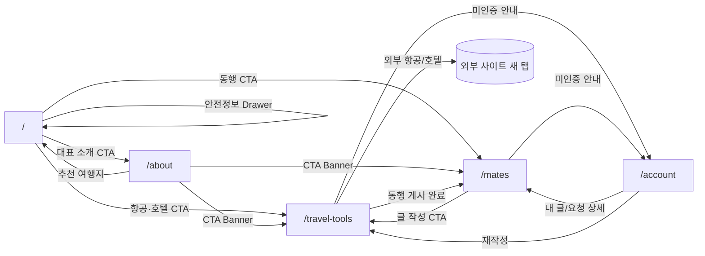

# Free Traveler UI/UX 계획 v1.0

- **Document ID:** UIUX-TRAVEL-001
- **기반 문서:** `docs/01_PRD.md`(PRD-TRAVEL-001), `docs/02_SRS_BASELINE.md`(SRS-TRAVEL-001), `docs/PROJECT_SCOPE.md`(SCOPE-TRAVEL-001), `docs/03_UI_COVERAGE_ANALYSIS.md`(UICOV-TRAVEL-001)
- **참고(스타일만 인용, 상표 요소 미사용):** `design-reference/vendor/airbnb/DESIGN-airbnb.md`
- **작성일:** 2026-09-10
- **상태:** UI/UX Design Baseline
- **대상 화면:** SCR-001~SCR-005 (5개 고정, `docs/03_UI_COVERAGE_ANALYSIS.md` 2장 정의를 그대로 승계)

이 문서는 UI Coverage Analysis가 5개 화면에 배치한 114개 요구사항(REQ-FUNC-001~080, REQ-NF-001~034)을 실제 화면 레이아웃·섹션 구성·상태·반응형 규칙으로 구체화한다. Airbnb 참고 문서는 "흰 배경 위 절제된 단일 포인트 컬러, 부드러운 곡률, 사진보다 여백을 신뢰하지 않는 카드 밀도"라는 **스타일 철학만** 인용하며, Airbnb 워드마크·서체명(Cereal)·컬러명(Rausch)·3-Product 내비게이션·Superhost 배지 등 상표적 요소는 그대로 사용하지 않는다.

---

## 1. 디자인 원칙 요약

1. **탐색 다음은 항상 다음 행동이다.** 모든 화면은 열람으로 끝나지 않고 `/travel-tools`, `/mates`, `/about`, 안전정보 Drawer 중 하나로 연결되는 CTA를 문맥에 맞게 노출한다.
2. **밀도 있는 정적 콘텐츠를 신뢰한다.** 여행지·안전정보·대표 소개는 `src/data` 정적 데이터이므로 로딩 실패보다 "콘텐츠가 비어 보이는" 상태를 더 경계한다 — 빈 Card, `준비 중`, Lorem ipsum을 금지하고 항상 안내문+다음 행동을 채운다.
3. **코랄은 절제해서 쓴다.** 1차 CTA·활성 탭·저장 상태·필수 배지에만 코랄을 쓰고, 오류·경고·안전 고지는 코랄과 구분되는 semantic color(적색·황색·청색)로만 표현한다.
4. **동행(F4) 흐름은 편의보다 안전을 우선한다.** 참가 요청·신고·차단 관련 화면 요소는 공개 연락처를 노출하지 않는 방향으로만 설계하고, 각 단계에 안전 고지를 반복 배치한다.
5. **Section은 목적이 다르면 패턴도 다르게 한다.** 같은 화면 안에서 Hero, Card Grid, 좌우 분할, Chip 목록, 3단계 안내, CTA Banner를 교차시켜 스크롤이 단조롭지 않게 한다(2장·4장 화면별 "패턴" 열 참고).

---

## 2. 공통 디자인 시스템

### 2-1. 브랜드 톤

| 항목 | 정의 |
|---|---|
| 브랜드명 | Free Traveler |
| 톤 | 실제로 여행해 본 사람의 담백한 안내. 과장된 마케팅 카피 대신 완성된 한국어 문장으로 설명한다. |
| 참고 범위 | Airbnb의 "흰 배경 + 절제된 단일 포인트 컬러 + 부드러운 곡률 + 사진 중심 카드" 스타일 철학만 인용한다. 워드마크, 서체명, 컬러명, 상품 탭 구조, 배지 명칭은 인용하지 않는다. |

### 2-2. 컬러 토큰

| 토큰 | HEX | 용도 |
|---|---|---|
| `color.canvas` | `#FFFFFF` | 기본 배경(흰 배경 원칙) |
| `color.surface-soft` | `#F7F6F4` | Section 배경 대비, 비활성 필드 |
| `color.surface-strong` | `#F1EFEC` | 카드 hover, Chip 선택 배경 |
| `color.ink` | `#222222` | 제목·본문 기본(짙은 회색 텍스트) |
| `color.body` | `#3F3F3F` | 긴 설명 본문 |
| `color.muted` | `#6B6B6B` | 보조 설명, 캡션, 비활성 라벨 |
| `color.muted-soft` | `#9B9B9B` | placeholder, 비활성 텍스트 |
| `color.hairline` | `#E3E1DE` | 카드·구분선 1px 테두리 |
| `color.border-strong` | `#C7C4C0` | 입력 필드 기본 테두리 |
| `color.coral` (Primary) | `#FF6B4A` | 1차 CTA, 활성 탭, 저장/선택 상태 |
| `color.coral-active` | `#E5522F` | 코랄 버튼 press 상태 |
| `color.coral-disabled` | `#FFD9CC` | 코랄 버튼 비활성 상태 |
| `color.on-coral` | `#FFFFFF` | 코랄 배경 위 텍스트 |
| `color.danger` / `color.danger-surface` | `#C4341F` / `#FDEDEA` | 오류, 중대 여행경보, 폼 검증 실패 |
| `color.warning` / `color.warning-surface` | `#9A6400` / `#FDF3DC` | stale(7일 초과) 경고, 주의 안내 |
| `color.success` / `color.success-surface` | `#1F7A4C` | 승인, 게시 완료, 저장 성공 |
| `color.info` / `color.info-surface` | `#2454B0` / `#EAF1FC` | 비전달 고지, 정책 안내, 포커스 링 |

> 오류·경고·안전정보는 `danger`/`warning`/`info`만 사용하고 코랄과 절대 혼용하지 않는다(공통 규칙). 색상만으로 상태를 구분하지 않고 아이콘+텍스트 라벨을 항상 병기한다.

### 2-3. 타이포그래피

- **폰트 스택:** `'Inter', 'Apple SD Gothic Neo', 'Malgun Gothic', sans-serif` — 한글 본문은 Inter가 커버하지 못하는 글리프를 시스템 한글 폰트로 자연 대체한다.

| 토큰 | Desktop | Mobile | Weight | Line-height | 용도 |
|---|---|---|---|---|---|
| `type.display` | 36px | 28px | 700 | 1.25 | Hero H1 |
| `type.h2` | 28px | 22px | 700 | 1.3 | Section 제목 |
| `type.h3` | 20px | 18px | 600 | 1.4 | 카드/서브 제목 |
| `type.body-lg` | 17px | 16px | 400 | 1.7 | Section 설명 문단 |
| `type.body` | 15px | 15px | 400 | 1.65 | 카드 본문, 리스트 |
| `type.caption` | 13px | 13px | 500 | 1.4 | 메타 정보, 날짜, 태그 |
| `type.button` | 16px | 16px | 600 | 1.25 | 버튼 라벨 |
| `type.chip` | 14px | 14px | 600 | 1.3 | Chip/필터 라벨 |

### 2-4. 형태·간격

| 토큰 | 값 | 용도 |
|---|---|---|
| `radius.sm` | 8px | 버튼, 입력 필드 |
| `radius.md` | 14px | 카드 |
| `radius.lg` | 20px | 모달/Drawer 패널, 모바일 Bottom Sheet 상단 |
| `radius.full` | 9999px | Chip, 아바타, 배지, 토글 |
| `space.4/8/12/16/24/32/48/64/96` | 4px 배수 | 전역 spacing scale |
| Section 상하 여백(Desktop) | 64~96px | 화면별 "콘텐츠 밀도" 규칙 |
| Section 상하 여백(Mobile) | 40~64px | 화면별 "콘텐츠 밀도" 규칙 |
| Desktop 콘텐츠 최대 폭 | 1200~1280px(기준 1240px, 좌우 padding 24px) | 전 화면 공통 |
| Card grid 간격 | Desktop 24px / Mobile 16px | Card Grid Section 공통 |

### 2-5. 반응형 기준

| 기준 | 값 |
|---|---|
| Desktop 기준폭 | 1440px |
| Mobile 기준폭 | 390px |
| Tablet 보조 분기 | 744px(2~3열로 전환, 화면별 4·5·6장에 명시) |
| Mobile Card 배치 | 1열 고정 |
| Mobile 상세 진입 | Drawer/Modal 대신 Bottom Sheet 또는 전체 화면 Drawer로 전환(화면별 명시) |

### 2-6. 접근성·터치 규칙

- 모든 인터랙션 요소의 터치 영역은 최소 44×44px을 확보한다(아이콘 버튼은 아이콘 24px + 패딩으로 44px를 채운다).
- 키보드 포커스는 `color.info`(#2454B0) 2px outline + 2px offset으로 전 컴포넌트에 통일 적용하고, `outline: none`으로 제거하지 않는다.
- 색상만으로 여행경보 단계·모집 상태를 구분하지 않고 텍스트 라벨(예: "여행유의", "모집중")을 항상 병기한다.
- 폼 오류는 해당 입력 필드와 `aria-describedby`로 연결하고, Drawer/Modal은 `role="dialog"` + `aria-modal="true"` + 포커스 트랩 + `Esc` 닫기를 적용한다.
- 이미지 alt 텍스트는 "실제 장소를 설명하는 문장"으로 작성한다(예: "제주 성산일출봉 전경" — "이미지1" 금지).

### 2-7. Header (5개 화면 공통)

| 항목 | Desktop | Mobile(390px) |
|---|---|---|
| 높이 | 72px, sticky top, 하단 1px hairline | 56px, sticky top |
| 좌측 | "Free Traveler" 워드마크(코랄 포인트 아이콘) → `/` | 워드마크(축약) + 햄버거 |
| 중앙 | 텍스트 내비게이션: 여행지 / 항공·호텔 찾기(`/travel-tools`) / 동행 찾기(`/mates`) / 대표 소개(`/about`) | 햄버거 시트에 동일 4개 링크 |
| 우측 | 검색 아이콘(Hero 검색으로 스크롤·포커스) · 즐겨찾기 아이콘(`/account` 활동 탭) · 계정 버튼(Guest: 코랄 "로그인" 버튼 → `/account`, Member: 아바타+닉네임 드롭다운) | 계정 진입은 시트 하단에 배치 |

### 2-8. Footer (5개 화면 공통)

| 컬럼 | 내용 |
|---|---|
| 브랜드 | Free Traveler 한 줄 소개 + 대표 소개(`/about`) 링크 |
| 바로가기 | 여행지, 항공·호텔 찾기, 동행 찾기, 국가별 주의사항 |
| 이용정책 | 이용약관, 개인정보처리방침, 동행 안전수칙 |
| 공식 출처·고지 | 외교부 해외안전여행 링크(새 탭) + "Free Traveler는 항공·호텔 예약을 대행하지 않으며 외부 서비스로 안내만 합니다." 고정 고지 |
| Legal band | Copyright, 문의 이메일 |

Mobile은 4개 컬럼을 1열로 스택하고 컬럼 간 여백을 32px로 압축한다.

---

## 3. 콘텐츠 밀도 규칙 (전 화면 적용)

- Header~Footer 사이 Section은 목적이 분명한 순서로 배치하며, 목적 없는 여백 Section을 두지 않는다.
- 각 Section은 **제목 + 1~3문장 설명 + 실제 콘텐츠 또는 명확한 CTA**를 최소 구성으로 갖는다.
- 1440px 화면에서 Hero가 전체 높이(100vh)를 차지하지 않도록 하고, 스크롤 없이도 다음 Section의 상단 일부가 보이게 한다(Hero 높이 가이드: 520~640px, 상세 수치는 화면별 4·5·6장 참고).
- Lorem ipsum, `준비 중`, `정보 확인 필요`류 플레이스홀더 문구를 쓰지 않는다. DB/정적 데이터가 비어 있는 경우에도 "왜 비어 있는지 + 무엇을 할 수 있는지 + 다음 행동 CTA"를 함께 표시한다(Empty State 공통 3요소).
- 같은 Card Grid 패턴을 연속 반복하지 않는다. 한 화면 안에서 최소 2가지 이상의 서로 다른 레이아웃 패턴(Hero, Card Grid, 좌우 분할, Chip 목록, 3단계 안내, CTA Banner, Timeline, Gallery, Tab Panel, 목록+상세 분할)을 교차한다.

---

## 4. SCR-001 — 메인(`/`)

**사용자 목표:** 국내·해외 여행지를 탐색하고, 안전정보를 확인한 뒤 다음 행동(항공/호텔/동행)을 정한다.

### 4-1. Section 구성 (7개)

| # | Section | 패턴 | 핵심 콘텐츠 | 연관 REQ | 다음 행동 |
|---|---|---|---|---|---|
| 1 | 여행지 검색 Hero | Hero | H1("어디로 떠날까요?" 류 완성 문장 헤드라인), 통합 검색창(REQ-FUNC-003/067, placeholder: "여행지, 국가, 주의사항 검색"), `/travel-tools` 보조 CTA("항공·호텔 조건 먼저 정리하기") | REQ-FUNC-003, 067, 064 | `/travel-tools` |
| 2 | 국내 인기 여행지 | Card Grid(6, Desktop 3×2 / Tablet 2×3 / Mobile 1열) | 여행지 카드(대표 이미지, 지역명, 테마 태그 1~2개, 한 줄 소개) | REQ-FUNC-001, 002, 004, 005, 009, 010, 068, 069 | 카드 클릭 → 여행지 상세 Drawer(같은 화면 내) |
| 3 | 해외 인기 여행지 | Card Grid(6, Section 2와 동일 그리드이나 카드 하단 배지를 "국가·안전정보 보기"로 달리하여 반복감 완화) | 여행지 카드 + 국가 안전정보 바로가기 배지 | REQ-FUNC-001, 002, 004, 005, 006, 009, 010, 068, 069 | 카드 클릭 → 상세 Drawer, 배지 클릭 → 안전정보 Drawer |
| 4 | 여행 동기·테마 | Chip 목록(가로 스크롤, 6개: 예- 휴양, 도심 탐방, 자연·트레킹, 미식, 문화·역사, 가족 여행) | Chip 선택 시 Section 2·3 카드가 즉시 필터링(REQ-FUNC-002 테마 조건) | REQ-FUNC-002 | 필터 반영 |
| 5 | 국가별 주의사항 | Card Grid(6, 국가명 + 경보 단계 텍스트 라벨 + 최종 확인일) | 카드 클릭 → 안전정보 Drawer(8개 카테고리, 출처, stale 경고) | REQ-FUNC-046~054, NF-028 | 안전정보 Drawer 열림 |
| 6 | 최근 동행 소식 | Card Grid(3) 또는 Empty State | 데이터 있음: 최근 등록 동행글 3개(국가·기간·모집 상태만 요약, 연락처 없음). 데이터 없음: "아직 등록된 동행글이 없습니다" 안내 + 이용 방법 2문장 + "동행글 작성하기" CTA | 크로스링크(SCR-004 데이터 참조) | `/mates`, `/mates/new` |
| 7 | free_traveler 요약 | CTA Banner(좌우 분할: 좌측 텍스트, 우측 대표 이미지) | 한 줄 소개, `50+ Trips` / `30+ Countries` 수치, "대표 소개 보기" CTA | REQ-FUNC-057 | `/about` |

### 4-2. 인터랙션 규칙

- 여행지 Card 선택 시 **같은 화면에서 우측(Desktop) 또는 하단 전체(Mobile) Drawer**를 열어 상세(필수 콘텐츠 11항목)를 표시한다. 페이지 이동 없이 뒤로가기/닫기(X, `Esc`, 배경 클릭)로 복귀한다.
- 해외 여행지 상세 Drawer 하단의 "국가별 주의사항 보기" 버튼은 같은 Drawer 스택 위에 안전정보 Drawer를 쌓아 연다(REQ-FUNC-006).
- 필터(Section 2·3·4)는 URL query에 반영·복원된다(REQ-FUNC-010).

### 4-3. 상태

| 상태 | 정의 |
|---|---|
| Loading | 초기 진입 시 Card Grid 스켈레톤(Section 2·3·5) |
| Success | 필터·검색 결과가 1건 이상 |
| Empty | 필터 결과 0건(Section 2·3·5) → 조건 완화 안내 + 초기화 버튼(REQ-FUNC-005). Section 6은 동행글 0건 시 3-요소 Empty State |
| Error | 안전정보 Drawer 내 외교부 외부 링크 열기 실패 → 인라인 오류 + 재시도 |
| Unauthorized | 해당 없음(전체 공개 화면) |

### 4-4. 반응형

- Desktop(1440px): Hero 높이 560px 내외로 다음 Section(국내 인기 여행지) 상단이 보임. Card Grid 3열.
- Tablet(744~1439px): Card Grid 2열, Chip 목록 가로 스크롤 유지.
- Mobile(390px): Hero 검색창은 풀폭 pill 입력, Card Grid 1열, 안전정보 Drawer는 Bottom Sheet(상단 `radius.lg`)로 전환.

---

## 5. SCR-002 — 대표 소개(`/about`)

**사용자 목표:** free_traveler의 경험·철학을 확인해 콘텐츠 신뢰도를 판단하고 추천 여행지로 이동한다.

### 5-1. Section 구성 (7개)

| # | Section | 패턴 | 핵심 콘텐츠 | 연관 REQ |
|---|---|---|---|---|
| 1 | free_traveler Hero | Hero(좌우 분할: 좌측 대표 이미지, 우측 텍스트) | 대표 이미지(alt: 실제 촬영 장소 설명), 한 문장 소개("50회 이상의 자유여행으로 30개국을 걸어온 여행 큐레이터") | REQ-FUNC-057, 061 |
| 2 | 여행 지표 | Stat Row(3개 수치 카드) | `50+ Trips`, `30+ Countries`, 대표 전문 영역(첫 자유여행 설계 등) 요약 배지 | REQ-FUNC-057 |
| 3 | 소개·철학 | 좌우 분할(좌측 소제목 Nav, 우측 2~4문단 본문) | 자기소개 1문단, 여행을 시작한 이유 1문단, 여행 철학 인용구 1문단(PRD 6-2 소개문 활용) | REQ-FUNC-058 |
| 4 | 여행 Timeline | Timeline(세로, 6개 이상 시점) | 연도·도시·한 줄 회고로 구성된 6개 이상 항목 | REQ-FUNC-060 |
| 5 | 방문 국가 | Chip 목록(권역별 그룹: 아시아/유럽/북미/오세아니아, 30개국 이상) | 권역 제목 + 국가 Chip, Chip 클릭 시 관련 여행지 있으면 SCR-001 여행지 Drawer로 연결 | REQ-FUNC-059 |
| 6 | 여행 사진 Gallery | Gallery(8장 이상, Masonry 또는 균등 그리드) | 서로 다른 장소의 사진 8장 이상, 각 alt는 실제 장소 설명 | REQ-FUNC-061 |
| 7 | 기억에 남는 여행지 | Card Grid(4) + CTA Banner | 추천 여행지 4개 카드(SCR-001 상세로 연결) + 하단 CTA Banner("여행 조건을 정리해볼까요?" `/travel-tools`, "함께 갈 동행을 찾아볼까요?" `/mates`) | REQ-FUNC-063 |

### 5-2. 상태

| 상태 | 정의 |
|---|---|
| Loading | Gallery 이미지 lazy load 중 블러 플레이스홀더 |
| Success | 기본 상태(정적 콘텐츠이므로 대부분 이 상태) |
| Empty | 해당 없음(콘텐츠는 항상 존재하는 정적 데이터) |
| Error | SNS/문의 외부 링크 열기 실패 시 인라인 안내 |
| Unauthorized | 해당 없음(전체 공개) |

### 5-3. 반응형

- Desktop: Section 1·3은 좌우 분할(예: 55/45), Section 7 Card Grid 4열.
- Mobile: 좌우 분할 Section은 이미지 위·텍스트 아래로 세로 스택, Gallery는 2열 그리드로 축소, Card Grid는 1열.

---

## 6. SCR-003 — 항공·호텔·동행 준비(`/travel-tools`)

**사용자 목표:** 항공·숙소 조건을 정리해 외부 예약 사이트로 이동하거나, 동행 모집글을 작성해 게시한다.

### 6-1. Section 구성 (6개)

| # | Section | 패턴 | 핵심 콘텐츠 | 연관 REQ |
|---|---|---|---|---|
| 1 | 페이지 Intro | Hero(축소형, 높이 240px 내외) | "무엇을 준비하시나요?" 헤드라인 + 이용 순서 3단계 요약(① 조건 입력 ② 요약 확인 ③ 외부 이동 또는 동행 게시) | 전체 화면 공통 안내 |
| 2 | 탭 전환 | Tab Panel(항공편 / 숙소 / 동행 구하기) | 탭마다 독립된 입력·검증·완료 상태를 유지(탭 전환 시 값 보존) | 전체 REQ의 상위 구조 |
| 3 | 조건 입력 Form | Form(2열 Desktop / 1열 Mobile) | 항공: 국가·지역·출발일·귀국일 / 숙소: 국가·지역·체크인·체크아웃. 국가 변경 시 지역 옵션 초기화 | REQ-FUNC-011, 012, 013, 019, 020, 021 |
| 4 | 입력 요약 Action Card | Split(좌측 요약 텍스트, 우측 "항공편 보러 가기" / "호텔 보러 가기" Action Card) | 검증 통과 후에만 노출, 코랄 버튼으로 외부 사이트를 새 탭(`noopener noreferrer`)으로 연결 | REQ-FUNC-014, 016, 022, 024 |
| 5 | 비전달 고지 + Tip | Info Banner(`color.info-surface`) + 3단계 안내 카드 | "입력하신 조건은 서버에 저장되거나 외부 사이트로 전달되지 않습니다" 고지 + 항공·숙소 찾기 Tip 3개(예: 왕복/편도 구분, 지역명 표기 팁, 성수기 확인 팁) | REQ-FUNC-015, 017, 023, 025 |
| 6 | 동행 탭 콘텐츠 | 조건부 렌더: Guest/성인미확인 → 로그인·성인확인 안내 카드 / Member → 작성 Form + 안전 안내 배너 | 모집 조건·설명 입력, 연락처 패턴 탐지 오류, 안전수칙 동의 체크박스 | REQ-FUNC-027, 028, 031, 032, 054, 080 |

### 6-2. 탭 간 상태 분리 규칙

- 항공/숙소/동행 세 탭은 **각자 독립된 입력값, 검증 오류, 완료 상태**를 가진다. 한 탭에서 검증 오류가 발생해도 다른 탭 상태에 영향을 주지 않는다.
- 항공·숙소 탭: `미입력 → 검증실패 → 유효(요약 표시) → 외부이동 성공/URL오류` 상태 흐름.
- 동행 탭: `비로그인/미인증 → 인증완료(작성 가능) → 검증실패(연락처 탐지 등) → 게시 완료` 상태 흐름.

### 6-3. 상태

| 상태 | 정의 |
|---|---|
| Loading | 외부 이동 버튼 클릭 직후 새 탭 오픈 대기 스피너(짧게, 200ms 내외) |
| Success | 요약 표시(항공/숙소) 또는 동행글 게시 완료 Toast |
| Empty | 해당 없음(폼 화면이므로 목록형 Empty는 없음). 동행 탭 미인증 상태는 Unauthorized로 별도 처리 |
| Error | 필수값 누락, 날짜 역전(REQ-FUNC-013/021), 연락처 패턴 탐지(REQ-FUNC-032), 외부 URL 미설정/오류(REQ-FUNC-018/026) |
| Unauthorized | 동행 탭에서 비로그인 또는 성인 확인 미완료 시 안내 카드 + `/account` 로그인 CTA로 전환(REQ-FUNC-027/028) |

### 6-4. 반응형

- Desktop: Section 3·4가 좌우 분할(입력 60% / 요약 40%)로 동시에 보임.
- Mobile: 입력 Form 작성 후 "요약 보기" 버튼으로 Section 4가 Form 아래에 이어 붙는 세로 스택. 탭은 상단 고정 Segmented Control로 축소.

---

## 7. SCR-004 — 동행 찾기(`/mates`)

**사용자 목표:** 조건이 맞는 동행 모집글을 찾아 참가를 요청하거나 신고·차단으로 자신을 보호한다.

### 7-1. Section 구성 (6개)

| # | Section | 패턴 | 핵심 콘텐츠 | 연관 REQ |
|---|---|---|---|---|
| 1 | Intro | Hero(축소형) + CTA | "동행을 찾고 계신가요?" 목적 설명 2문장 + "동행글 작성하기" 코랄 CTA(`/travel-tools` 동행 탭) | 전체 화면 공통 |
| 2 | 검색 Filter + 결과 요약 | Filter Bar(국가·지역·기간·연령대·성별·스타일·모집 상태) + 결과 카운트 텍스트 | "조건에 맞는 모집글 N건" 요약 | REQ-FUNC-030 |
| 3 | 동행글 목록 | Card Grid/List(최대 8개 우선 노출, 이후 더보기) | 국가·지역·기간·모집 상태 배지·간단 소개(연락처 비노출) | REQ-FUNC-030, 033, 037 |
| 4 | 목록+상세 분할 | Desktop: 좌우 분할(좌 목록 40% / 우 상세 60%) · Mobile: 목록→상세 Drawer(전체 화면) | 상세: 조건·설명·작성자 요약, 참가 요청 폼(500자), 신고·차단 버튼 | REQ-FUNC-034, 035, 039, 040 |
| 5 | 동행 신청 방법 | 3단계 안내(가로 스텝: ① 조건 확인 ② 참가 메시지 작성 ③ 작성자 승인 대기) | 짧은 설명 + 아이콘 | 신규 사용자 온보딩(REQ-FUNC-034 보조 설명) |
| 6 | 안전 안내 + CTA Banner | Info/Warning Banner + CTA Banner | "안전한 만남을 위한 안내"(공개 만남 장소, 개인정보 공유 자제, 신고·차단 방법 요약) + "여행 조건을 먼저 정리하고 만나보세요" `/travel-tools` CTA | REQ-FUNC-039, 040, 043 |

### 7-2. 참가·신고·차단 인터랙션

- 참가 요청 제출: PENDING 저장 → Toast "요청이 전달되었습니다" → 상세 패널 내 상태 배지가 즉시 "요청됨"으로 갱신(REQ-FUNC-034/043).
- 중복 요청: 이미 PENDING/ACCEPTED 상태면 참가 요청 버튼이 비활성 + 안내 문구로 대체(REQ-FUNC-035).
- 신고: 사유 코드 선택 + 설명 입력 → 제출 즉시 접수번호 Toast(REQ-FUNC-039).
- 차단: 확인 다이얼로그 → 완료 후 목록·상세에서 상호 콘텐츠 즉시 제외(REQ-FUNC-040).

### 7-3. Empty State (검색 결과 0건)

Empty State는 다음 3요소를 항상 함께 표시한다.
1. 검색 조건 초기화 버튼("조건 초기화하고 전체 보기")
2. 동행글 작성 CTA("먼저 글을 남겨보세요")
3. 이용 방법 요약(Section 5의 3단계 안내를 축약 재사용)

### 7-4. 상태

| 상태 | 정의 |
|---|---|
| Loading | 목록 스켈레톤(Section 3), 상세 패널 스켈레톤(Section 4) |
| Success | 목록·상세 정상 표시 |
| Empty | 검색 결과 0건(7-3 규칙 적용), 종료일 경과 글은 목록에서 자동 제외 |
| Error | 상세 로드 실패, 참가 요청/신고/차단 제출 실패 시 인라인 오류 + 재시도 |
| Unauthorized | 글쓰기·참가 요청 시도 시 비로그인/성인 미확인 → 안내 배너 + `/account` 로그인 유도(REQ-FUNC-027) |

### 7-5. 반응형

- Desktop(1440px): Section 4는 좌 목록/우 상세 고정 좌우 분할.
- Mobile(390px): Section 3 목록은 1열 Card, 카드 클릭 시 Section 4 상세가 전체 화면 Drawer(Bottom-to-top)로 전환되며 상단 "목록으로" 버튼으로 복귀.

---

## 8. SCR-005 — 계정(`/account`)

**사용자 목표:** 로그인·인증 상태를 관리하고 내 활동을 확인하며, 관리자는 신고와 외부 URL을 처리한다.

> 라우팅 메모: 본 화면은 UI Coverage 상 단일 Screen(`/account`, 4개 탭)으로 정의된다. 실제 구현에서 내 활동/관리자 기능이 `PROJECT_SCOPE.md`의 `/my/*`, `/admin/*` 라우트로 나뉘더라도, 사용자에게는 `/account` 진입점 아래 탭 전환으로 보이도록 라우팅을 구성한다.

### 8-1. 역할별 탭 구성(역할에 없는 탭은 렌더링하지 않음)

| 역할 | 노출 탭 | 탭별 핵심 콘텐츠 | 연관 REQ |
|---|---|---|---|
| **Guest** | 로그인/가입 | Intro(계정으로 할 수 있는 것 요약) + 로그인/가입/비밀번호 재설정 3개 Card(좌우 분할 또는 Card Grid 3) + "로그인 후 가능한 기능" 3단계 안내(동행 참가, 즐겨찾기, 신고·차단) + 보안 안내 Banner(개인정보 최소 수집 원칙) | REQ-FUNC-066 |
| **Member** | 프로필 · 내 활동 | **프로필 탭:** 닉네임·연령대·성별·스타일·자기소개 Form + 성인 확인 상태 요약 배지. **내 활동 탭:** 내 동행글 관리(수정/마감), 참가 요청함(승인/거절), 차단 목록, 즐겨찾기 목록, "새 동행글 작성" CTA(`/travel-tools`) | REQ-FUNC-028, 029, 036, 038, 040, 068 |
| **Admin** | 관리자 | Intro("신고 처리와 외부 링크만 관리합니다" 범위 고지) + 신고 큐(OPEN/RESOLVED/DISMISSED 필터, 상태 변경) + 항공·호텔 외부 URL 설정 Form(HTTPS 허용목록 검증) | REQ-FUNC-041, 042, 077 |

### 8-2. Empty State 규칙

내 활동 탭의 각 목록(내 글 / 참가 요청 / 차단 / 즐겨찾기)이 비어 있을 때는 목록별로 다음을 표시한다.
- 내 글 없음 → "아직 작성한 동행글이 없습니다" + "동행글 작성하기" CTA
- 참가 요청 없음 → "받은 참가 요청이 없습니다" + 동행 목록으로 이동 CTA
- 차단 목록 없음 → "차단한 사용자가 없습니다" + 안전 안내 링크
- 즐겨찾기 없음 → "찜한 여행지가 없습니다" + `/` 여행지 탐색 CTA

### 8-3. 상태

| 상태 | 정의 |
|---|---|
| Loading | 탭 전환 시 목록/폼 스켈레톤 |
| Success | 로그인 완료, 프로필 저장 완료, URL 저장 완료 Toast |
| Empty | 8-2 규칙(내 글/요청/차단/즐겨찾기 각각) |
| Error | 회원가입/로그인 실패, 프로필 저장 실패, 외부 URL 유효성 오류(HTTPS 외 스킴 거부) |
| Unauthorized | Member 탭에 비로그인 접근 시 로그인 탭으로 리다이렉트, Admin 탭에 비관리자 접근 시 403 안내 화면(홈으로 복귀 CTA 포함) |

### 8-4. 반응형

- Desktop: 좌측 세로 탭 Nav + 우측 콘텐츠 영역(좌우 분할).
- Mobile: 상단 가로 스크롤 탭으로 전환, 콘텐츠는 탭 아래 세로 스택.

---

## 9. 전체 화면 공통 상태 (404/500/권한없음/외부연결실패)

| 오류 유형 | 화면 구성 | 복구 행동 |
|---|---|---|
| 404 | 아이콘 + "페이지를 찾을 수 없습니다" | 홈으로 이동 CTA |
| 500 | 아이콘 + "일시적인 오류가 발생했습니다" | 다시 시도 + 홈으로 이동 |
| 권한 없음(403) | 아이콘 + "접근 권한이 없습니다" | 로그인(Guest) 또는 홈으로 이동(Member) |
| 외부 연결 실패 | 인라인 배너("외부 사이트로 이동할 수 없습니다") | 다시 시도 버튼(같은 화면 유지, 새 탭 재오픈 시도) |

모든 오류 화면은 최소 1개의 명확한 복구 행동(홈/이전/재시도)을 제공하며, Dashboard형 통계 화면이나 복잡한 관리자 그래프는 만들지 않는다(REQ-FUNC-078 범위).

---

## 10. Screen 간 이동 지도

---

## 11. 요구사항 커버리지 재확인

`docs/03_UI_COVERAGE_ANALYSIS.md`에서 UI_DIRECT/UI_STATE로 분류된 68개 요구사항(REQ-FUNC 56 + REQ-NF 12 중 화면에 반영되는 항목)은 본 문서 4~9장의 Section·상태 표에 모두 1회 이상 인용되었다. NON_UI·OPERATIONS 항목은 화면 요소로 나타나지 않으므로 본 문서에서 별도 배치하지 않고 원 문서의 분류를 그대로 유지한다.

> **다음 단계:** 본 문서의 Section·상태 정의를 기준으로 컴포넌트 단위 와이어프레임 또는 Figma 목업을 제작하고, `src/app` 라우트 구조와 Section 컴포넌트를 매핑한다.
