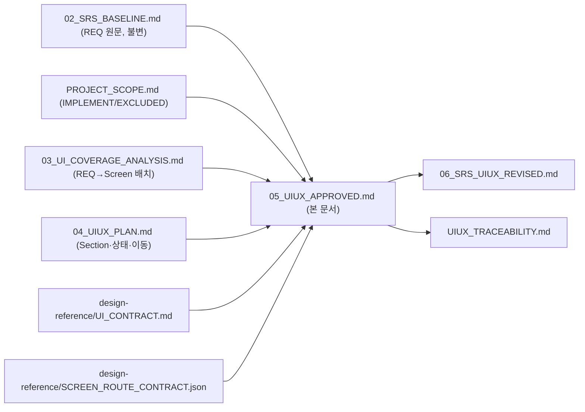

# Free Traveler — UI/UX Approved Baseline v1.0

- **Document ID:** UIUXAPR-TRAVEL-001
- **기반 문서:** `02_SRS_BASELINE.md`(SRS-TRAVEL-001), `PROJECT_SCOPE.md`(SCOPE-TRAVEL-001), `03_UI_COVERAGE_ANALYSIS.md`(UICOV-TRAVEL-001), `04_UIUX_PLAN.md`(UIUX-TRAVEL-001), `../design-reference/UI_CONTRACT.md`, `../design-reference/SCREEN_ROUTE_CONTRACT.json`, `../design-reference/D-001/DESIGN.md`
- **작성일:** 2026-09-15
- **상태:** Approved (Screen·Route·Scope 연결 승인)
- **적용 대상:** SCR-001~SCR-005 (5개 고정)

이 문서는 `02_SRS_BASELINE.md`가 정의한 REQ-FUNC-001~080·REQ-NF-001~034(총 114개, 전량 유지)와 `PROJECT_SCOPE.md`의 IMPLEMENT/EXCLUDED 결정을, 승인된 5개 디자인 Screen(SCR-001~SCR-005) 및 Next.js App Router 구현 계약(`../design-reference/UI_CONTRACT.md`, `../design-reference/SCREEN_ROUTE_CONTRACT.json`)에 공식 연결한다. 이 문서는 요구사항을 새로 만들거나 삭제하지 않으며, 화면·라우트 구조를 확정하고 릴리스 수용 기준을 추가한다.

---

## 1. 승인된 5개 Screen

| Screen ID | 이름 | Route | Page Entry | 분류 |
|---|---|---|---|---|
| SCR-001 | 홈 | `/` | `src/app/page.tsx` | 핵심 |
| SCR-002 | 대표 소개 | `/about` | `src/app/about/page.tsx` | 핵심 |
| SCR-003 | 항공·호텔·동행 준비 | `/travel-tools` | `src/app/travel-tools/page.tsx` | 핵심 |
| SCR-004 | 동행 찾기 | `/mates` | `src/app/mates/page.tsx` | 핵심 |
| SCR-005 | 계정 | `/account` | `src/app/account/page.tsx` | 보조 |

핵심 4개(SCR-001~004)는 제품의 1차 가치 제안(탐색·신뢰·전환·동행)을 직접 담당하고, 보조 1개(SCR-005)는 인증·프로필·내 활동·관리자 기능으로 핵심 화면을 지원한다. 상세 근거는 `../design-reference/UI_CONTRACT.md` §0을 따른다.

각 Screen에 대해 다음이 모두 참(true)이어야 승인 상태를 유지한다: `page_owner_task_required=true`, `preview_required=true`(`../design-reference/SCREEN_ROUTE_CONTRACT.json` 참고). SCR-001은 추가로 `starter_template_forbidden=true` — 현재 `src/app/page.tsx`는 `create-next-app` 기본 스타터 상태이므로 이 조건은 아직 충족되지 않았다(§5 Release Acceptance Criteria 참고).

---

## 2. 기존 공개 Route의 5개 Screen 통합

`PROJECT_SCOPE.md` §3과 `02_SRS_BASELINE.md` §3.5가 나열한 개별 공개 Route는 5개 Screen의 탭·패널·모달·Drawer로 통합된다. 아래 표는 통합 전/후 대응 관계다.

| 통합 이전 Route(구) | 통합 이후 위치 |
|---|---|
| `/destinations`, `/destinations/domestic`, `/destinations/overseas`, `/destinations/[slug]` | SCR-001(`/`)의 Card Grid + `DestinationDetailDrawer` |
| `/safety`, `/safety/[countryCode]` | SCR-001(`/`)의 `SafetyInfoDrawer`(여행지 Drawer 위 스택) |
| `/flights` | SCR-003(`/travel-tools`)의 "항공" 탭 |
| `/hotels` | SCR-003(`/travel-tools`)의 "숙소" 탭 |
| `/mates/new` | SCR-003(`/travel-tools`)의 "동행 구하기" 탭(작성 Form) |
| `/mates`, `/mates/[id]` | SCR-004(`/mates`)의 목록+상세 분할(패널) |
| `/about` | SCR-002(`/about`) — 독립 유지 |
| `/auth/*` | SCR-005(`/account`)의 로그인/가입 탭 |
| `/my/*` | SCR-005(`/account`)의 프로필·내 활동 탭 |
| `/admin/*` | SCR-005(`/account`)의 관리자 탭(Admin 역할만 노출) |

이 통합에 따라 `PROJECT_SCOPE.md` §3의 Route 목록과 `02_SRS_BASELINE.md` §3.5 Page and Route Inventory는 **UI 라우팅 구조 기준으로는 이 문서와 `06_SRS_UIUX_REVISED.md`가 대체**한다. `PROJECT_SCOPE.md`가 REQ 단위로 내린 IMPLEMENT/EXCLUDED 결정 자체는 변경되지 않고 그대로 유효하다.

---

## 3. UI Route Contract

전체 스키마는 `../design-reference/SCREEN_ROUTE_CONTRACT.json`(`schema_version: traveler-screen-route-v1`, `framework: nextjs-app-router`)을 정본으로 한다. 요약은 다음과 같다.

### 3-1. Screen 계약 플래그

| Screen ID | page_owner_task_required | preview_required | starter_template_forbidden |
|---|:---:|:---:|:---:|
| SCR-001 | true | true | **true** |
| SCR-002 | true | true | - |
| SCR-003 | true | true | - |
| SCR-004 | true | true | - |
| SCR-005 | true | true | - |

### 3-2. 기술 Route(Screen 수에 포함하지 않음)

| 유형 | Route | 파일 |
|---|---|---|
| Supabase 인증 콜백 | `/auth/callback` | `src/app/auth/callback/route.ts` |
| API Route | `/api/*` | `src/app/api/**/route.ts` |
| Not Found | `*`(전역 404) | `src/app/not-found.tsx` |

### 3-3. 필수 화면 간 이동(required_navigation 요약)

| From | To | 트리거 |
|---|---|---|
| SCR-001 | SCR-002 | free_traveler 요약 CTA Banner |
| SCR-001 | SCR-003 | Hero 보조 CTA |
| SCR-001 | SCR-004 | 최근 동행 소식 카드/작성 CTA |
| SCR-001 | external | 안전정보 Drawer 내 외교부 원문 링크 |
| SCR-002 | SCR-001 | 추천 여행지 카드 클릭 |
| SCR-002 | SCR-003 | CTA Banner |
| SCR-002 | SCR-004 | CTA Banner |
| SCR-002 | external | 문의·SNS 링크 |
| SCR-003 | external | 항공편/호텔 보러 가기(새 탭, query 없음) |
| SCR-003 | SCR-004 | 동행 게시 완료 |
| SCR-003 | SCR-005 | 동행 탭 비로그인·성인 미확인 안내 |
| SCR-004 | SCR-003 | 동행글 작성하기 CTA |
| SCR-004 | SCR-005 | 비로그인·성인 미확인 안내 |
| SCR-005 | SCR-004 | 내 글·참가 요청 상세 이동 |
| SCR-005 | SCR-003 | 동행글 재작성 |

전체 규칙(Section 순서, 상태, 사용자 행동, Desktop·Mobile 규칙, 금지 기능)은 `../design-reference/UI_CONTRACT.md`를 정본으로 한다.

---

## 4. 요구사항 연결 요약

| 구분 | 개수 |
|---|---:|
| REQ-FUNC-001~080 (원문 유지) | 80 |
| REQ-NF-001~034 (원문 유지) | 34 |
| **합계(삭제 없음)** | **114** |
| IMPLEMENT (Screen·Route에 연결, 현재 코드 상태는 NOT_STARTED) | 90 |
| EXCLUDED (`PROJECT_SCOPE.md` 결정 그대로 유지, EXCLUDED로 표시) | 24 |

전체 114개 요구사항의 Screen/Route/Page Entry/Task/Test 매핑은 `UIUX_TRACEABILITY.md`에 1행씩 기록되어 있으며, 요구사항 원문은 `06_SRS_UIUX_REVISED.md` §4에 전량 재수록되어 있다. 어떤 요구사항도 이번 연결 작업으로 삭제·병합되지 않았다.

EXCLUDED로 유지된 24개 요구사항은 다음 사유 그룹으로 분류된다(전체 목록은 `PROJECT_SCOPE.md` §5~7, ID 목록은 `UIUX_TRACEABILITY.md` §15 참고).

| 사유 그룹 | 대표 REQ ID |
|---|---|
| 콘텐츠 CMS·미디어 라이선스 워크플로 미구축 | REQ-FUNC-007, 061, 072, 073, 074, REQ-NF-029 |
| Editor/Moderator 세분화 권한·감사 로그 미구축 | REQ-FUNC-045, 055, 056, 075, 076, REQ-NF-018, 020, 021, 022, 032 |
| 행동 분석·성능 CI·장애 알림 자동화 미구축 | REQ-FUNC-071, REQ-NF-007, 008, 009, 010, 011, 024, 033 |

이 사유들은 `PROJECT_SCOPE.md`가 이미 확정한 것이며, 본 문서와 `06_SRS_UIUX_REVISED.md`는 이를 변경하지 않고 화면 연결 정보만 추가한다.

---

## 5. Release Acceptance Criteria

아래 조건을 모두 만족해야 MVP 릴리스를 승인할 수 있다. 어떤 항목도 현재 시점(코드 미작성)에서는 충족되지 않았으며, 이는 정상이다 — 이 목록은 구현 완료 이후의 통과 기준이다.

### 5-1. Screen·Route 구조

| 기준 | 확인 방법 |
|---|---|
| SCR-001~SCR-005 정확히 5개, Route·Page Entry 각각 중복 없음 | `../design-reference/SCREEN_ROUTE_CONTRACT.json` 스키마 검증 |
| SCR-001의 `src/app/page.tsx`에 `create-next-app` 기본 스타터 마크업(Next.js 로고, "To get started" 문구, Vercel/Docs 버튼)이 남아있지 않음 | 코드 리뷰 |
| `/travel-tools`에 항공·숙소·동행 구하기 3탭이 모두 구현되어 있음 | 수동 QA + Playwright SM-02/03/05 |
| `/account`에 인증·프로필·내 활동·관리자(역할 게이팅) 4개 영역이 모두 구현되어 있음 | 수동 QA + Playwright SM-04/06/07/10 |
| §3-3의 필수 화면 간 이동이 모두 동작함 | 수동 QA(화면 전환 경로 전수 확인) |

### 5-2. 요구사항 커버리지

| 기준 | 확인 방법 |
|---|---|
| Priority M(Must)로 표시된 REQ-FUNC 중 IMPLEMENT로 분류된 전체 항목이 `UIUX_TRACEABILITY.md`에서 Status=`OPEN`이 아닌 완료 상태로 전환됨(본 문서 개정 시점 기준 목표) | `UIUX_TRACEABILITY.md` 전수 확인 |
| EXCLUDED 24개 항목이 실수로 구현되어 범위가 암묵적으로 확장되지 않았음 | 코드 리뷰(§6 금지 기능 대조) |
| REQ-FUNC-001~080, REQ-NF-001~034 중 어떤 ID도 문서에서 누락되지 않음 | `UIUX_TRACEABILITY.md` §15 집계 검증 |

### 5-3. 금지 기능 미포함(`../design-reference/D-001/DESIGN.md` §17, `../design-reference/UI_CONTRACT.md` 공통 금지 기능과 동일)

| 기준 |
|---|
| 예약하기·결제하기·가격비교·재고확인 등 구매/예약/결제 UI가 어떤 화면에도 없음 |
| 항공·호텔 입력값이 서버 DB·로그·분석 이벤트·외부 URL 쿼리 어디에도 저장·전달되지 않음(네트워크 탭 실측) |
| 동행 모집글·상세·카드 어디에도 전화번호·이메일·메신저 ID가 노출되지 않음 |
| 별점·리뷰 점수·좋아요 수·실시간 항공권/호텔 가격 배지가 없음 |
| Airbnb 로고·Rausch 계열 색상·Airbnb Cereal 폰트 등 상표 요소가 없음 |
| 라이선스 미확인 Proprietary 폰트 파일이 프로젝트에 없음 |
| Lorem ipsum·"준비 중"·"정보 확인 필요" 플레이스홀더 및 빈 Card가 없음 |

### 5-4. 콘텐츠·접근성

| 기준 | 확인 방법 |
|---|---|
| 국내 여행지 10개 이상, 해외 15개국 30개 도시 이상 게시(REQ-FUNC-008) | 수동 콘텐츠 체크리스트 |
| 게시된 모든 해외 국가에 안전정보 페이지 존재(REQ-FUNC-046, REQ-NF-027) | 수동 데이터 커버리지 확인 |
| WCAG 2.2 Level AA 목표 수준의 키보드·스크린리더 동작(REQ-NF-023, 025) | 수동 접근성 점검 |
| 320px 모바일부터 데스크톱까지 가로 스크롤·겹침 없음(REQ-FUNC-065) | 브라우저 반응형 점검 |

### 5-5. 테스트 실행

| 기준 | 확인 방법 |
|---|---|
| `PROJECT_SCOPE.md` §9의 Playwright 핵심 Smoke Test SM-01~SM-10 전체 통과 | CI Playwright 실행 결과 |
| `tsconfig` strict 모드, `next lint` 통과(REQ-NF-031) | CI |

이 기준을 충족하기 전까지 어떤 Screen도 "구현 완료"로 표시하지 않는다.

---

## 6. 문서 관계

